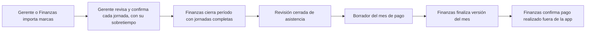

# Diseño de software de Planilla Patty

Consolidación revisada y aprobada por Diego el 11 de noviembre de 2026. Base integrada bd0878c. Algunas reglas aprobadas todavía no están en master; cada una indica el issue que la integra. El estado de implementación se distingue de la aprobación de una regla.

## Alcance y referencias

Planilla reúne personal, relaciones laborales, horarios, marcas del huellero, revisión de asistencia y preliquidación mensual auditable. Permite rastrear importes hasta sus hechos, fuentes y reglas. Finanzas registra la constancia de pagos ejecutados externamente. La aplicación no ejecuta transferencias, no genera PLAME y no expone una API pública.

El vocabulario se mantiene en [CONTEXT](../CONTEXT.md). Los [ADR](adr) conservan decisiones y motivos. La interfaz se describe en [Diseño visual](diseno-visual.md). Este documento consolida las reglas de producto y deja al implementador la elección de tablas, funciones y organización fina de archivos. La configuración del repo para desarrollar está en [AGENTS](../AGENTS.md) y en [Desarrollo y validación](desarrollo.md).

Cada tarea enlaza las secciones de este diseño que la limitan. Si una tarea descubre un comportamiento nuevo o contradice este diseño, primero se actualiza el diseño y se revisa la decisión; la tarea no resuelve esa discrepancia por su cuenta.

## Arquitectura y responsabilidades

La aplicación es un monolito TypeScript con Next.js, PostgreSQL y Drizzle. Los módulos colaboran mediante casos de uso internos. La organización observada separa interfaz en src/app, operaciones de dominio y repositorios de persistencia. Los detalles internos pueden evolucionar respetando estas responsabilidades y los contratos de datos. Fuentes de arquitectura en ADR 0003 y 0014.

| Módulo | Responsabilidad y datos que controla |
|---|---|
| Autenticación y configuración | Cuentas, rol, asignación de gerentes, grupos, sedes y configuración operativa |
| Personal y relaciones laborales | Identidad por DNI, grupo y vigencia confirmada de ingreso/cese |
| Horarios | Modelos, borradores, publicación semanal y correcciones auditadas por fecha |
| Importaciones | Archivo fuente, hash, marcas crudas y propuestas vinculadas al horario |
| Asistencia | Jornada revisada, situación diaria, minutos, sustento y confirmación del gerente |
| Períodos | Rango de revisión, completitud, cierre, reapertura y revisiones históricas |
| Condiciones y reglas | Valores laborales y monetarios con vigencia y procedencia |
| Fuentes externas | Conceptos, importes, procedencia y confirmación de listados mensuales |
| Pagos | Entrada preparada, cálculo, bloqueos, versiones finales, exportación y constancia de pago |

## Identidad, permisos y población

El DNI es la identidad de negocio compartida con el huellero. Un identificador técnico enlaza datos internos. La persona puede tener relaciones laborales sucesivas. Un DNI desconocido en una importación genera una incidencia; su alta requiere el flujo de Personal. Fuente en ADR 0010.

Las autorizaciones se comprueban en el servidor y se reutilizan desde casos de uso, acciones, páginas y navegación. La matriz está en src/autenticacion/permisos.ts. Un grupo tiene como máximo un gerente; un gerente puede gestionar varios grupos. Fuentes en ADR 0012 y sus enmiendas.

| Rol | Responsabilidad |
|---|---|
| Administrador | Configuración global, cuentas y delegación operativa temporal definida por ADR 0012 |
| Gerente de área | Personas de sus grupos, modelos, horarios y confirmación de jornadas con sobretiempo |
| Recursos Humanos | Ingresos y ceses, su confirmación y correcciones autorizadas |
| Finanzas | Cuentas de gerente/RRHH y asignaciones, importación alternativa, revisión y cierre de períodos y funciones monetarias |

Pagos y sus datos monetarios son accesibles para Finanzas y para el Administrador, también por URL y servidor; gerentes de área y Recursos Humanos no acceden. El acceso del Administrador fue decidido por Diego el 11 de noviembre de 2026 y está pendiente de implementación: el código actual todavía lo reserva a Finanzas. El Administrador opera igual que Finanzas: importa y confirma fuentes, edita condiciones y reglas, finaliza el mes y confirma el pago.

Un grupo con Gestiona asistencia y horarios desactivado integra la población de Pagos por sus relaciones laborales, sin exigirle horarios ni marcas para cerrar asistencia. La sede de adscripción contable y la sede de una jornada tienen significados distintos.

## Relaciones laborales

Ingreso y cese se registran y confirman por separado. El ingreso confirmado abre la vigencia; el cese confirmado la cierra. Se impiden solapes y más de una relación abierta. La publicación respeta esos intervalos y representa los días exteriores como Sin relación laboral.

RRHH y Administrador pueden corregir fechas confirmadas con motivo, antes/después, autor, revisión de concurrencia e historial inmutable. Conserva la confirmación original y las marcas. Solo las fechas donde cambia la vigencia requieren reevaluación. Una fecha cerrada exige reapertura; un pago confirmado impide la corrección que lo afectaría. Los horarios futuros que quedan fuera se convierten con auditoría; ampliar vigencia exige replanificar esos días. Integración pendiente de #186.

## Horarios y publicación

Se prepara y publica la semana completa por persona, respetando grupo y vigencia. Los estados distinguen borrador, publicado, cambios sin publicar y protección por cierre. El modelo de horario usado puede renombrarse conservando sus referencias (integración pendiente de #187).

Publicación, importación y confirmación diaria pueden preceder a la apertura de un período (integración pendiente de #184 y #185). El corte posterior reúne los hechos de sus fechas. Una semana que cruza el corte se publica completa; el cierre cubre su propio intervalo.

Las correcciones posteriores registran motivo e historial y afectan únicamente las fechas cambiadas. Conservan las marcas como evidencia y requieren nueva revisión de las jornadas afectadas. Una fecha cerrada exige reapertura. La publicación coordina sus escrituras con el cierre para evitar resultados parciales o incompatibles. La corrección de republicación tras Completar semana guarda el borrador y el sustento (integración pendiente de #181).

La vista mensual consulta jornadas y abre la semana correspondiente. Editar un día desde el mes y cargar un patrón mensual están propuestos en #182/#183; su implementación sigue pendiente.

## Importación y asistencia diaria

La importación conserva el archivo original, su ubicación, hash y marcas crudas vinculadas a sede/persona/fecha. Las propuestas pueden revisarse y corregirse manteniendo trazabilidad. Fuente en ADR 0005. La confirmación es una acción explícita del gerente.

La jornada conserva el horario aplicado y los datos necesarios para explicar el cálculo. Una corrección guarda el motivo e invalida la revisión afectada. Los estados manuales requieren situación explícita; la ausencia de marcas por sí sola no acredita ausencia laboral.

La confirmación de cada jornada sustituye la aprobación global de grupo. Confirmar incluye el sobretiempo del día. Desde 30 minutos exige sustento. Finanzas consulta pendientes y sustentos y cierra el período cuando sus fechas están completas. Integración pendiente de #187.

En Tienda, los turnos de nueve horas incluyen una hora de refrigerio. Un domingo publicado es jornada ordinaria. Las extras pertenecen a su jornada; superar 48 horas ordinarias genera una alerta semanal para revisar horarios. Se conservan los minutos de trabajo, incluidas las fracciones de hora, según el cálculo existente. Ejemplo aprobado: tramo 11:30–20:38, una hora de refrigerio, 488 minutos trabajados, ocho minutos extra al 25 % y cero al 35 %. Las dos primeras horas extra diarias se valoran al 25 % y las siguientes al 35 % conforme al glosario y las reglas de Pagos.

## Períodos, cierre y contrato hacia Pagos

Finanzas abre rangos sin solapamiento. La población y fechas exigibles se obtienen de relaciones laborales y grupos que gestionan asistencia. Los días incompletos se identifican por persona, fecha y causa. El cierre exige jornadas resueltas y sustentos requeridos.

Cerrar conserva una revisión identificable de hechos diarios. Reabrir exige motivo. Corregir y confirmar otra vez permite un nuevo cierre, conservando revisiones anteriores. El bloqueo transaccional del cierre se coordina con escrituras de horarios, marcas, jornadas y vigencias. Las comprobaciones de este bloqueo en una copia del ensayo siguen pendientes; la implementación local no las acredita.

Asistencia entrega a Pagos revisión, fechas cubiertas, persona, grupo, sede, horario aplicado, situación, minutos y referencias de evidencia; los motivos detallados y las marcas crudas permanecen en Asistencia. Pagos obtiene su población de las relaciones laborales, no de las filas de asistencia, y una jornada puede originar varios conceptos, ninguno o una reclasificación de sueldo. El borrador puede usar hechos abiertos rotulados provisionales. La finalización exige revisiones cerradas que cubran exactamente el corte 26–25, sin huecos, solapamientos ni períodos que crucen su límite.

## Pagos

Las subsecciones siguientes incorporan el detalle del diseño anterior de Pagos. Las referencias a #96 conservan la procedencia de su alcance; las reservas se mantienen en la sección final.

### Datos y fuentes de Pagos

Las condiciones laborales y reglas monetarias conservan vigencia histórica. Finanzas mantiene sueldo, jornada ordinaria diaria, régimen, afiliación pensionaria, elegibilidad familiar, sede de adscripción y demás valores requeridos por #96. Las tasas y topes tienen fuente oficial y responsable de activación. Una versión final conserva los valores y versiones aplicados.

Para valorar horas extra, «elegibilidad familiar» significa que Patty ya verificó el sustento y otorgó la asignación familiar fuera de la app. Si está activa, integra la remuneración ordinaria computable incluso para REMYPE pequeña empresa; la app no guarda el DNI del menor. La base incluye sueldo básico y esa asignación otorgada. Excluye las comisiones de ventas de la fuente externa, que son remuneración complementaria variable, conforme al [artículo 11 del D. S. 007-2002-TR](https://cdn.www.gob.pe/uploads/document/file/289875/Compendio_normas_laborales_29-01-19.pdf). Si una persona cobra comisiones como remuneración principal en vez de complemento al sueldo, este cálculo no modela ese caso y requiere una regla específica antes de usarlo.

Las fuentes externas usan conceptos catalogados. Cada importe conserva DNI, fecha del hecho, mes de devengue, mes de aplicación, monto y procedencia. Finanzas confirma cada tipo de fuente para el mes completo y declara completo el listado para la población aplicable. La ausencia de una fila equivale a cero solo después de esa confirmación. La importación de XLSX conserva archivo, hash, responsable y validaciones. Un importe calculado se corrige en su fuente o mediante ajuste trazable; no se sobrescribe la línea final.

La población se obtiene de las relaciones laborales y las reglas del corte de #96. El sueldo usa el mes calendario; las incidencias variables usan el corte 26–25; cada línea conserva el mes de devengue aunque se aplique después. Esos tres tiempos permanecen distintos en contratos, cálculos y exportación.

### Cálculo, borrador y finalización

El caso de uso reúne la entrada de un mes: población, relaciones laborales, condiciones vigentes, revisiones de asistencia, reglas y fuentes externas. El cálculo recibe esa entrada coherente sin consultar fuentes cambiantes por su cuenta. Devuelve por persona los conceptos tipados, bases independientes, aportes, neto, procedencia y bloqueos. Un borrador muestra solo resultados calculables y distingue faltantes de ceros; no presenta un neto incompleto como definitivo.

El cálculo aplica las decisiones de #96 para prorrateos, vacaciones, sobretiempo, tardanza real, feriados y descansos, bases legales, fuentes externas y redondeo. No presupone una relación de un estado de asistencia por una línea de dinero. Redondea cada línea monetaria a céntimos con mitad hacia arriba y suma las líneas ya redondeadas; conserva minutos sin redondear antes de valorarlos.

**Trabajo en descanso o feriado (#124).** Una jornada trabajada en el descanso semanal asignado o en un feriado, sin descanso sustitutorio, genera la línea «Trabajo en descanso o feriado sin sustitución»: remuneración ordinaria computable × minutos trabajados ÷ (30 × jornada ordinaria diaria) × (1 + sobretasa). Los minutos de horas extra del mismo día se valoran en su propio concepto y no se cuentan aquí. La sobretasa es una regla legal con vigencia, una para el feriado o descanso y otra para el 1 de mayo; sin regla vigente la persona queda bloqueada. Un sustitutorio previsto u otorgado no genera línea. Uno no otorgado paga en el mes del día de origen si se verificó (en Lima) hasta el día 25 de su corte; si se verificó después, se regulariza en el pago cuyo corte contiene la verificación, con el devengue original. El estado del sustitutorio se lee en vivo y no de la revisión congelada, para no pagar dos veces. **Pendiente de validar con Finanzas o el contador:** la fórmula y ambas sobretasas (#96). Las reglas legales aceptan de 0 a 100 %; si el 1 de mayo exige más, hace falta un cambio de esa restricción.

**Vacaciones entre meses (#125).** Los días del descanso no los digita Finanzas: salen de las jornadas «vacaciones» que el gerente aprobó en el calendario de Asistencia, y un descanso es una racha de días consecutivos. Como el sueldo es del mes calendario y el corte llega al día 25, Pagos lee también los hechos de vacaciones posteriores al corte, de períodos aún abiertos, que se muestran como provisionales; esa lectura no cambia la cobertura del corte ni lo que exige finalizar. Cada mes del descanso muestra sus días calendario; la remuneración vacacional del mes sustituye el sueldo básico de esos días con la convención de 30 (el día 31 no suma y febrero completa los 30) y usa el sueldo vigente al inicio del descanso. Si el sueldo vigente cambia durante el descanso, Pagos calcula una línea de ajuste trazable con la diferencia, y el total del mes sigue siendo el del sueldo vigente. Finanzas registra solo el abono anticipado (persona, fecha e importe): se ata al descanso más cercano que empiece en o después de su fecha, se reparte entre los meses del descanso en proporción a su remuneración vacacional, que con la base del inicio del descanso equivale a sus días convencionales (los céntimos sobrantes van al último mes; con día 31 o fin de febrero esto difiere del reparto por días calendario y evita saldos negativos artificiales; la regla se validará con el contador) y reduce una sola vez el saldo de cada mes. Un abono sin descanso asociable bloquea a la persona en su mes de aplicación. Límite conocido: el grupo Administración no gestiona asistencia, no tiene calendario y por ahora no recibe este desglose; sus vacaciones se pagan como sueldo normal hasta que se decida cómo registrarlas.

Finanzas finaliza el mes completo o no finaliza a nadie. La operación exige cobertura exacta del corte, jornadas confirmadas y revisiones cerradas, fuentes completas, reglas disponibles, casos soportados y netos válidos. Si los datos relevantes cambiaron desde el borrador revisado, solicita revisar el cálculo actualizado. Guarda una versión inmutable con importes, bases, reglas, fuentes y actor. Antes de pagar puede crear una nueva versión final sin editar las anteriores. Finanzas confirma cuál versión se pagó realmente; se registra fecha y responsable. No se añade un bloqueo automático distinto del circuito explícito de reapertura y nueva confirmación de jornadas.

### Comportamientos de interacción incorporados

El [diseño visual](diseno-visual.md) fue aprobado por Diego el 2026-10-05 y añade estos comportamientos, que este diseño y #96 recogen:

- Confirmar un tipo de fuente es reversible antes de finalizar: Finanzas puede devolverlo a «Pendiente». Importar otro archivo del mismo tipo y mes reemplaza al anterior y devuelve la fuente a «Pendiente». Una importación con errores no carga ninguna fila.
- Ajustes de preliquidación, abonos anticipados de remuneración vacacional y descansos sustitutorios previstos se cargan como tipos de fuente de Pagos. Las condiciones laborales con vigencia y las reglas legales son secciones de Pagos (tickets #116 y #117). Un valor mal registrado se corrige reemplazándolo con motivo, solo si ningún mes finalizado lo usa; si lo usó, se corrige con un ajuste de preliquidación.
- Las versiones finalizadas anteriores se consultan completas en solo lectura.
- Con personas bloqueadas, los totales del mes suman solo las calculadas y se rotulan «Incompleto».
- Antes de confirmar el pago, si cambió solo una fuente o una regla y la asistencia no cambió, se puede crear otra versión desde un borrador recalculado y revisado, sin reabrir períodos. Cambió la asistencia: se aplica el recorrido de reapertura, corrección, nueva confirmación de jornadas y nuevo cierre.
- Un cambio desde el borrador revisado es cualquier dato de entrada del cálculo, aunque el neto no varíe.
- Al confirmar el pago, Finanzas registra la fecha del pago y la app guarda la fecha de la confirmación. Bloquear «Reabrir período» de los períodos fuente se implementa en el mismo ticket que registra el pago.

## Consistencia, auditoría y conservación

Cada transición y su auditoría se guardan en la misma transacción. Los datos externos conservan procedencia; los importes finales conservan fuentes y versiones de reglas. Las operaciones de corrección detectan revisiones obsoletas y protegen cierres y pagos. Los reintentos de importación respetan la detección de duplicados por hash y filas de negocio.

La confirmación del pago corresponde a una versión del mes completo y registra fecha del pago y responsable. Bloquea reemplazar esa versión y reabrir sus períodos fuente, según ADR 0013. El flujo de subsanación posterior al pago permanece reservado.

## Comprobaciones

- Probar los permisos en casos de uso y borde HTTP: gerente limitado a sus grupos, Recursos Humanos limitado a relaciones laborales, y decisiones monetarias y cierre reservados a los roles que este diseño autoriza.
- Probar que la falta de horario o de situación resuelta bloquee el cierre; que una corrección invalide la confirmación afectada; y que un cierre o un pago realizado impidan modificaciones indebidas.
- Probar la cobertura exacta de revisiones del corte y que la población incluya a personas sin marcas, en vacaciones o con ingreso/cese pertinente.
- Probar cálculos con casos sintéticos de fechas, minutos, sueldo cambiante, vacaciones entre meses, bases independientes, conceptos externos y redondeo. Usar los ejemplos de #96 como criterios de aceptación.
- Probar fuentes no confirmadas frente a fuentes confirmadas sin importes, duplicados e importaciones inválidas.
- Probar finalización atómica, relectura cuando cambian datos, conservación de versiones previas, constancia de la versión pagada y exportación.
- Ejecutar `pnpm validate` y revisar las rutas afectadas en navegador, incluido ancho estrecho y estados de error.

## Estado de integración y decisiones pendientes

- Base integrada revisada bd0878c. Hay reglas aprobadas con código de ensayo pendiente de integración: publicación semanal (#184), registro y cierre de asistencia (#185), corrección de relaciones laborales (#186), sobretiempo y modelos (#187) y vista mensual con republicación (#181).
- El acceso del Administrador a Pagos está decidido y no tiene issue todavía.
- Siguen pendientes las consultas a Finanzas sobre EsSalud en mes incompleto, devengues anteriores y cobertura incompleta.
- #124 cerrado conserva explícita la validación de fórmula y sobretasas de descanso/feriado con Finanzas o contador. El cierre del issue acredita entrega técnica, no resuelve por sí mismo esa reserva.
- #125 está cerrado. El diseño fuente conserva reserva sobre reparto del abono vacacional. La lectura del issue y sus comentarios no aportó una decisión posterior que permita retirar esa reserva.
- Antes del uso real falta contrastar un mes de referencia con el Excel anterior y documentar cada diferencia.
- El registro de vacaciones de grupos sin asistencia y la subsanación posterior al pago siguen con el alcance limitado descrito por sus fuentes.
- Las secciones de condiciones laborales y reglas legales, añadidas al diseño de interacción después del 5 de octubre, fueron aprobadas por Diego el 11 de noviembre de 2026.

## Procedencia

Fuentes: CONTEXT, ADR 0001–0014 y los diseños anteriores de software y de interacción de Pagos (retirados en #188 y consultables en el historial de Git). Fuentes posteriores: decisiones de Diego de octubre y noviembre de 2026 y escenarios aprobados del 7 de noviembre, en integración por #181 y #184–#187.
